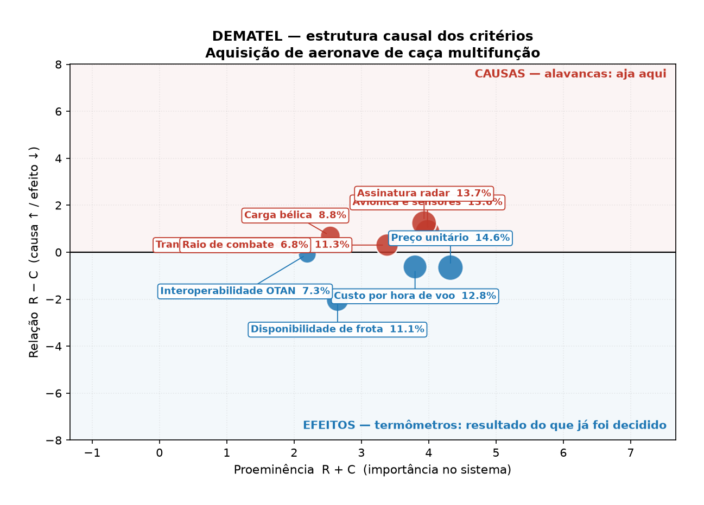
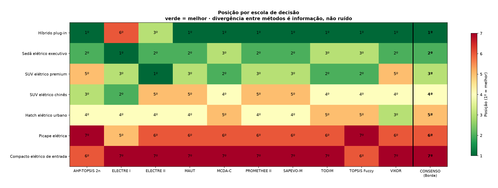
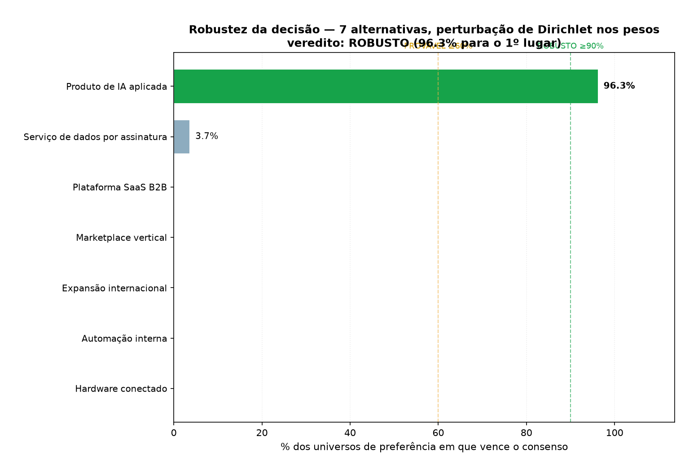
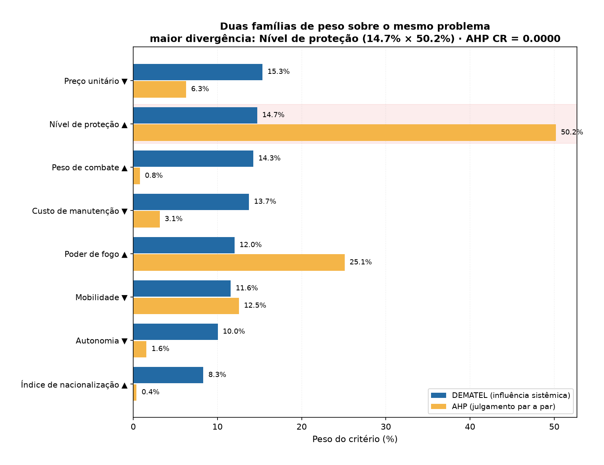
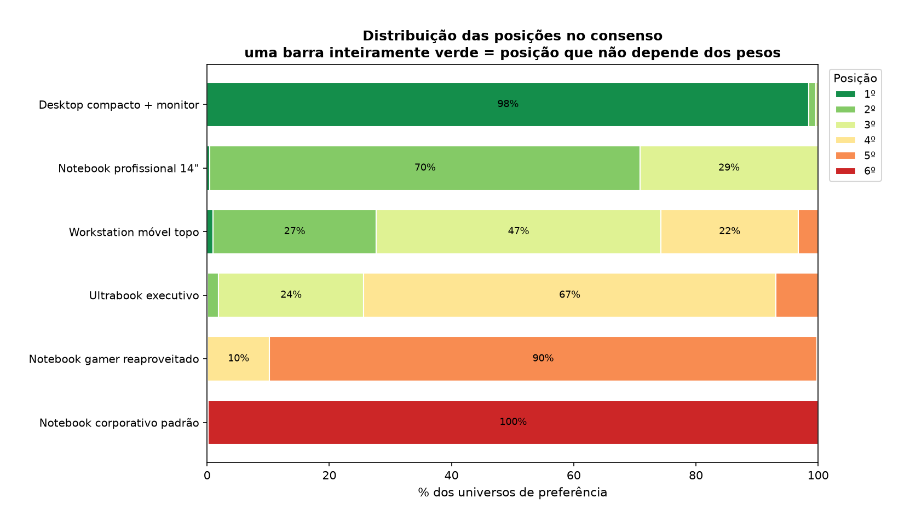

<!--
MCDM Studio — Modelos Multicritério de Decisão
Autor: ProfBru - Bruno Penedo © 2026 - TODOS OS DIREITOS RESERVADOS
E-mail: profbruanbima@gmail.com
-->

<div align="center">

# 🎯 MCDM Studio — Модели многокритериального принятия решений


**ProfBru © 2026**

### Перестаньте выбирать с помощью таблицы. Начните решать на основании доказательства.

**Десять школ принятия решений. Один победитель. И — впервые — вероятность того, что этот победитель верен.**

[](#-девять-школ-принятия-решений--и-почему-именно-девять)
[](#-два-независимых-движка-перекрёстная-проверка)
[](#-12-языков--память-переводов-sdl-trados)
[](#-вопрос-на-который-никто-не-отвечает-а-если-веса-неверны)

[](https://www.python.org)
[](https://www.rust-lang.org)
[](https://numpy.org)
[](https://numba.pydata.org)
[](https://evidence.dev)
[](https://sqlite.org)
[](#-лицензия-и-авторство)

🌐 [Português](README.md) · [English](README.en.md) · [Español](README.es.md) · [Français](README.fr.md) · [Deutsch](README.de.md) · [中文](README.zh.md) · [한국어](README.ko.md) · [हिन्दी](README.hi.md) · [עברית](README.he.md) · **Русский** · [Svenska](README.sv.md) · [Suomi](README.fi.md)

</div>

---

## 💀 Боль: вы уже теряли деньги из-за таблицы

Вспомните последнее дорогое решение, которое вы приняли. Покупка автомобиля. Выбор поставщика. Утверждение проекта. Выбор ноутбука, которым 200 человек будут пользоваться четыре года.

**Вы открыли таблицу. Варианты в строках, атрибуты в столбцах. А затем сделали одно из трёх:**

| Что вы сделали | Что произошло на самом деле |
|---|---|
| 🔻 **Отсортировали по столбцу цены** | Вы выбрали самое дешёвое. Для этого таблица была не нужна. |
| 🔺 **Отсортировали по оценке эксперта** | Вы выбрали самое дорогое. Для этого она тоже была не нужна. |
| 🔍 **Отфильтровали по «соответствует всем требованиям»** | Список оказался пуст. Тогда вы ослабили одно требование. Какое? **То, которое мешало.** |

> [!WARNING]
> **У всех трёх операций один и тот же изъян: ни одна не отвечает на заданный вами вопрос.**
> Вопрос был *«среди взаимно противоречивых вариантов — какой выбрать?»* — а сортировка по столбцу это, по определению, решение по **одному** критерию. Остальные семь вы не использовали. Они были там лишь для вашего спокойствия.

И есть проблема, которой никто не видит: **вы сложили то, что уже было сложено.** Вы дали 20 % «энергопотреблению» и 25 % «запасу хода» — но потребление *порождает* запас хода. Вы посчитали одно и то же дважды и назвали это анализом.

### Момент, когда решение умирает

Это происходит на совещании. Вы представляете рейтинг. Кто-то из комитета спрашивает:

> *А если бы запас хода стоил 30 %, а не 25 %?*

И вы не знаете. **Никто не знает.** Потому что таблица возвращает **одно** число с подразумеваемой стопроцентной уверенностью, которой у неё быть не может. Вы возвращаетесь с домашним заданием, меняете веса и обнаруживаете, что второе место становится первым при разнице в **два процентных пункта**.

Тот «победитель» никогда победителем не был. Он был **артефактом вашей калибровки** — и вы едва не подписали это.

---

## 💊 Решение: десять школ, один консенсус и доверительный интервал

**MCDM Studio запускает **девять признанных многокритериальных методов** на одной и той же задаче, выводит победителя из **консенсуса** между ними, а затем делает единственное, что действительно важно:**

> ### 🎲 Он возмущает веса **2 000 раз** и считает, в скольких вселенных победитель продолжает побеждать.

Вердикт перестаёт быть числом и становится **фразой, которая переживает комитет**:

<div align="center">

| ❌ Что говорит таблица | ✅ Что говорит MCDM Studio |
|---|---|
| «Модель C — лучшая.» | **«Модель C побеждает в 96 % правдоподобных вселенных предпочтений. Вердикт РОБАСТНО: выбор не зависит от тонкой настройки весов.»** |
| *(ответа нет)* | **«Модель A побеждает в 51 %. Вердикт ХРУПКО: первое место — артефакт весов. Не решайте только по рейтингу.»** |

</div>

**Обратите внимание на второй случай. Честная система обязана уметь сказать *«здесь мне не доверяйте»*. В этом и разница между поддержкой решения и генератором оправданий для решения, которое вы уже хотели принять.**

---

## 🖼️ Посмотрите, как это работает

### 1. Кто причина, а кто следствие — до всякого взвешивания

<div align="center"></div>

**Какую боль это снимает:** вы назначаете веса, предполагая независимость критериев. **Они почти никогда не независимы.** Энергопотребление *порождает* запас хода. Броня *порождает* массу, которая *порождает* потерю подвижности. Складывать их как независимые — считать дважды.

**DEMATEL** строит матрицу полных отношений `T = X(I−X)⁻¹` — суммирующую прямые **и косвенные** влияния любой длины пути — и разделяет то, за что можно **потянуть** (причины, выше линии), и то, что лишь **измеряет результат** (следствия, ниже). Веса берутся оттуда: из системного влияния, а не из интуиции.

> В приведённом случае **передача технологий** и **радиолокационная заметность** — ПРИЧИНЫ: изменение их сдвигает всю систему. **Готовность парка** — СЛЕДСТВИЕ, термометр, а не рычаг. Тендер, который оценивает готовность и игнорирует передачу технологий, измеряет температуру и не замечает инфекции.

### 2. Десять школ на одной задаче

<div align="center"></div>

**Какую боль это снимает:** в каждый метод MCDM встроена теория о том, что означает «лучше» — и она меняет победителя. Выбрать метод и представить результат — значит выбрать результат.

Мы запускаем все девять. Когда они совпадают, выбор **не является артефактом метода**. Когда расходятся — **расхождение и есть находка**.

> Выше: **подключаемый гибрид** занимает 1-е место в семи методах, но **6-е в ELECTRE I**. Это не шум — это информация. ELECTRE I допускает *вето*: он утверждает, что у гибрида есть достаточно тяжёлый недостаток по какому-то критерию, чтобы быть отсеянным, каким бы хорошим он ни был в остальном. **Именно этот вопрос вы и хотите вынести на комитет.**

### 3. Доверительный интервал самого решения

<div align="center"></div>

**Какую боль это снимает:** вопрос комитета — *«а если бы вес был другим?»*. Отвечен **до** того, как кто-то его задал.

Мы возмущаем веса как `w' ~ Dirichlet(κ·w)` и переранжируем 2 000 раз. Дирихле — естественный выбор: её носитель есть в точности симплекс (положительные веса с суммой 1), и она удовлетворяет `E[w'] = w` — то есть мы возмущаем **без смещения**.

### 4. Где ваша интуиция ошибается

<div align="center"></div>

**Какую боль это снимает:** вы полагаете, что знаете, что важно. Два семейства весов проверяют это.

**AHP** (Саати) попарно спрашивает, насколько один критерий важнее другого. **DEMATEL** измеряет системное влияние. **Там, где они расходятся, и находится эффект второго порядка, который вы недооценили** — и график помечает наибольшее расхождение красным.

### 5. Где оказывается каждая альтернатива в 2 000 сценариев

<div align="center"></div>

Полностью зелёная полоса — это место, которое **не зависит от весов**. Пёстрая полоса — оспариваемое место. Вы с одного взгляда видите, где рейтинг является фактом, а где мнением.

---

## 🎯 Для чего это нужно — выбор по мерке

Движок **не зависит от предметной области**: единицей является *случай принятия решения* (альтернативы × критерии) без встроенной бизнес-семантики. Сменить область — значит сменить данные, а не код.

<div align="center">

| Область | Решение | Конкретная боль |
|---|---|---|
| 📱 **Электроника** | Телефон, ноутбук, оборудование | У самого дешёвого худшая камера; у лучшего по камере — худшая батарея. «Лучшего» не существует — существует **лучшее для вашего сценария**. |
| 🚗 **Электромобили** | Автопарк или личное использование | Запас хода, зарядка, сервисная сеть и остаточная стоимость тянут в разные стороны. А решающий критерий (**реальный запас хода**, а не каталожный) труднее всего измерить. |
| 🎖️ **Оборона** | Истребители, бронемашины, БПЛА, база тылового обеспечения | Жизненный цикл 30 лет, необратимо, под общественным контролем. **Цена единицы — менее трети полной стоимости.** Передача технологий и стоимость лётного часа определяют бюджет на три десятилетия. |
| 🏢 **Корпоративное** | Поставщик, ERP, аутсорсинг, расширение | Комитет, который не согласен сам с собой. **SAPEVO-M** создан именно для этого: он агрегирует порядковые суждения **нескольких лиц, принимающих решения**, не требуя предварительного консенсуса. |
| 🚀 **Стартапы** | Портфель проектов, распределение капитала | Тот, кто решает по ожидаемой доходности, всегда выбирает самую рискованную ставку — **математическое ожидание игнорирует хвост**. Здесь риск — это **критерий**, а не сноска на 14-м слайде. |
| 💻 **ИТ** | Стандартизация парка техники | Решение умножается на 200 и действует 4 года. Время автономной работы и гарантия с выездом стоят в совокупной стоимости владения больше, чем два балла синтетического бенчмарка. |

</div>

### Готовые к запуску случаи

```bash
python3 pipeline.py --listar
```

| # | Случай | Область | Альтернативы | Критерии | Вердикт | Авторы / источник |
|--:|---|---|--:|--:|---|---|
| 1 | `smartphone` | потребительский | 6 | 8 | ВЕРОЯТНЫЙ 63% | Собственное моделирование |
| 2 | `veiculo_eletrico` | автомобильный | 7 | 8 | УСТОЙЧИВЫЙ 99% | Собственное моделирование |
| 3 | `caca_multifuncao` | оборона | 6 | 9 | УСТОЙЧИВЫЙ 100% | Собственное моделирование |
| 4 | `blindado` | оборона | 5 | 8 | УСТОЙЧИВЫЙ 93% | Собственное моделирование |
| 5 | `portfolio_startup` | корпоративный | 7 | 9 | УСТОЙЧИВЫЙ 96% | Собственное моделирование |
| 6 | `estacao_trabalho` | ИТ | 6 | 8 | УСТОЙЧИВЫЙ 98% | Собственное моделирование |
| 7 | `carros_eletricos` | автомобильный | 38 | 9 | УСТОЙЧИВЫЙ 96% | Собственное моделирование |
| 8 | `smartphones_2026` | потребительский | 38 | 9 | ВЕРОЯТНЫЙ 73% | Собственное моделирование |
| 9 | `tablets` | потребительский | 34 | 8 | ВЕРОЯТНЫЙ 67% | Собственное моделирование |
| 10 | `smartwatches` | потребительский | 31 | 8 | ВЕРОЯТНЫЙ 84% | Собственное моделирование |
| 11 | `notebooks` | ИТ | 32 | 8 | ВЕРОЯТНЫЙ 83% | Собственное моделирование |
| 12 | `maquinario_agricola` | агробизнес | 35 | 8 | УСТОЙЧИВЫЙ 100% | Собственное моделирование |
| 13 | `sbc_iot` | ИТ | 33 | 8 | УСТОЙЧИВЫЙ 100% | Собственное моделирование |
| 14 | `mineracao_asic` | инфраструктура | 31 | 8 | НЕУСТОЙЧИВЫЙ 50% | Собственное моделирование |
| 15 | `minipcs` | ИТ | 10 | 8 | УСТОЙЧИВЫЙ 91% | Собственное моделирование |
| 16 | `impressoras_3d_miniaturas` | производство | 30 | 9 | НЕУСТОЙЧИВЫЙ 48% | Собственное моделирование |
| 17 | `impressoras_3d_producao` | производство | 30 | 9 | НЕУСТОЙЧИВЫЙ 58% | Собственное моделирование |
| 18 | `plotters_formato` | производство | 24 | 9 | УСТОЙЧИВЫЙ 96% | Собственное моделирование |
| 19 | `impressoras_3d_miniaturas_triadas` | производство | 13 | 9 | УСТОЙЧИВЫЙ 100% | Собственное моделирование |
| 20 | `acoes_b3` 📚 | финансы | 20 | 7 | НЕУСТОЙЧИВЫЙ 39% | COSTA, L. S. da · VÁSQUEZ, J. A.; ESCOBAR, J. W.; MANOTAS, D. F. · [DOI](https://doi.org/10.3390/risks10010004) |
| 21 | `fundos_imobiliarios` 📚 | финансы | 18 | 8 | ВЕРОЯТНЫЙ 85% | SANTOS, V. V. dos (orient. ALMEIDA FILHO, A. T. de) |
| 22 | `fintech` 📚 | финансы | 16 | 8 | ВЕРОЯТНЫЙ 67% | WIBOWO, S.; GRANDHI, L.; GRANDHI, S.; WELLS, M. · [DOI](https://doi.org/10.3390/math10020225) |
| 23 | `avaliacao_imoveis` 📚 | недвижимость | 16 | 8 | УСТОЙЧИВЫЙ 94% | DUARTE, D. C. de O. · MARQUES, J. P. M. |
| 24 | `ordens_servico` 📚 | операции | 18 | 8 | УСТОЙЧИВЫЙ 97% | ALENCAR, L. G. de; TAVARES, F. R. M.; MENDONÇA, F. J. S. de F.; DUARTE, A. K. G. |
| 25 | `cloud_providers` 📚 | ИТ | 14 | 8 | УСТОЙЧИВЫЙ 100% | SOLOMON, T. |
| 26 | `venture_capital` 📚 | корпоративный | 16 | 8 | УСТОЙЧИВЫЙ 96% | BEIM, G.; LÉVESQUE, M. · DHOCHAK, M.; DOLIYA, P. · AFFUL-DADZIE, E.; AFFUL-DADZIE, A.; OPLATKOVÁ, Z. K. · [DOI](https://doi.org/10.1002/mcda.1703) |
| 27 | `instrutores` 📚 | корпоративный | 15 | 8 | УСТОЙЧИВЫЙ 100% | SILVA, C. E. J. da; SALLES-NETO, L. L. de; SANTOS, M. dos |
| 28 | `cripto_portfolio` 📚 | финансы | 9 | 7 | УСТОЙЧИВЫЙ 100% | ALJINOVIĆ, Z.; MARASOVIĆ, B.; ŠESTANOVIĆ, T. · [DOI](https://doi.org/10.3390/math9141677) |
| 29 | `portfolio_crise` 📚 | финансы | 8 | 4 | ВЕРОЯТНЫЙ 77% | COSTA, I. P. de A.; MAÊDA, S. M. do N.; TEIXEIRA, L. F. H. de S. de B.; GOMES, C. F. S.; SANTOS, M. dos |
| 30 | `cenarios_va` 📚 | автомобильный | 16 | 9 | ВЕРОЯТНЫЙ 73% | LI, S.; ZHOU, R.; HUANG, H. · [DOI](https://doi.org/10.1007/s42154-024-00344-6) |
| 31 | `impressora_3d_energia` 📚 | производство | 12 | 7 | ВЕРОЯТНЫЙ 69% | OLIVEIRA, V. A. R. de; ALVARADO SILVA, C. A.; OLIVEIRA, G. C. R. de; TAJIMA, F. M.; FARIA NETO, A. dos R.; SALOMON, V. A. P.; GUIDI, E. S. · [DOI](https://doi.org/10.18687/LACCEI2025.1.1.1193) |
| 32 | `impressoras_juridico` 📚 | операции | 12 | 4 | УСТОЙЧИВЫЙ 100% | OLIVEIRA, N. C.; OLIVEIRA, P. F. C. de; GOMES, C. F. S.; SANTOS, M. dos |
| 33 | `fundos_hedge` 📚 | финансы | 20 | 8 | УСТОЙЧИВЫЙ 94% | SILVA, F. P. da; RIBEIRO, C. de O. |
| 34 | `modelos_previsao` 📚 | ИТ | 7 | 8 | УСТОЙЧИВЫЙ 95% | SHAH, S. |
| 35 | `policultivo_rj` 📚 | агробизнес | 8 | 8 | ВЕРОЯТНЫЙ 86% | PENEDO, B. |
| 36 | `parafusadeiras_domesticas` 📚 | потребительский | 14 | 8 | ВЕРОЯТНЫЙ 70% | COMPROU AVALIOU (canal) · [vídeo](https://youtu.be/pgdqVYEjZtk) |
| 37 | `parafusadeiras_profissionais` 📚 | производство | 12 | 8 | УСТОЙЧИВЫЙ 100% | FERRAMENTAS EM AÇÃO — ASSIS PIRES (canal) · [vídeo](https://youtube.com/shorts/9SIs3agoZKc) |
| 38 | `crowdfunding_startups` 📚 | корпоративный | 16 | 9 | УСТОЙЧИВЫЙ 93% | SKARE, M.; GAVUROVA, B.; POLISHCHUK, V. · [DOI](https://doi.org/10.1016/j.jbusres.2023.113719) |

> [!NOTE]
> Матрицы случаев **иллюстративны** — публичные и правдоподобные порядки величин для демонстрации метода. **Неиллюстративным** является **моделирование**: критерии, направления, каузальная матрица DEMATEL и матрица Саати. Именно в ней заключена ценность. **Замените числа своей котировкой, своим тендером или своими лабораторными испытаниями** — движок тот же; данные ваши.

> [!TIP]
> **Вердикт** измеряет, в скольких из 2 000 смоделированных вселенных предпочтений победитель продолжает побеждать при возмущении весов по Дирихле (κ=200). **УСТОЙЧИВЫЙ** ≥ 90%: выбор не зависит от калибровки. **ВЕРОЯТНЫЙ** 60–89%: второе место конкурентоспособно, сравните оба. **НЕУСТОЙЧИВЫЙ** < 60%: первое место — артефакт весов, и это законный результат, а не сбой. Значит, данные не решают, и решение возвращается к человеку.

### 📚 Кейсы, выведенные из литературы

> [!IMPORTANT]
> У кейсов в таблице ниже **критерии и причинная структура взяты из перечисленных работ** — рецензируемых статей, диссертаций, материалов конференций и технических отчётов. Критерии не выдуманы: они взяты из исходного текста, а авторство сохранено здесь и в заголовке соответствующего модуля. **Числовые матрицы** — наши собственные построения; никакие данные из оригинальных работ не воспроизводились. Где есть индексируемый DOI, ссылка ведёт к работе; где его нет, полного текстового описания достаточно, чтобы её найти.

| Случай | Область | Авторы | Ссылка |
|---|---|---|---|
| `acoes_b3` | финансы | COSTA, L. S. da · VÁSQUEZ, J. A.; ESCOBAR, J. W.; MANOTAS, D. F. | *Uma metodologia para a pré-seleção de ações utilizando o método multicritério TOPSIS* (COSTA, UERJ) · *AHP–TOPSIS Methodology for Stock Portfolio Investments*, Risks, v.10, n.1, 4, 2022 (Universidad del Valle) · [DOI](https://doi.org/10.3390/risks10010004) |
| `fundos_imobiliarios` | финансы | SANTOS, V. V. dos (orient. ALMEIDA FILHO, A. T. de) | *Avaliação do método Random Forest para auxílio à seleção de fundos de investimento imobiliário listados na Bolsa de Valores*. Trabalho de Graduação, Engenharia da Computação, CIn/UFPE, set. 2023 |
| `fintech` | финансы | WIBOWO, S.; GRANDHI, L.; GRANDHI, S.; WELLS, M. | *A Fuzzy Multicriteria Group Decision Making Approach for Evaluating and Selecting Fintech Projects*. Mathematics, v.10, n.2, 225, 2022 — CQUniversity, Austrália · [DOI](https://doi.org/10.3390/math10020225) |
| `avaliacao_imoveis` | недвижимость | DUARTE, D. C. de O. · MARQUES, J. P. M. | *Análise multicritério e geoestatística aplicadas na avaliação em massa de imóveis urbanos*. Tese, UFV, 2019 · *As formas de avaliar imóvel em leilão judicial*. Universidade São Judas Tadeu, 2023 |
| `ordens_servico` | операции | ALENCAR, L. G. de; TAVARES, F. R. M.; MENDONÇA, F. J. S. de F.; DUARTE, A. K. G. | *Priorização de ordens de serviço aplicando métodos de tomada de decisão: o AHP integrado ao PROMETHEE*. Revista Produção Online, v.22, n.2, p.2763-2784, 2022 — URCA, Ceará |
| `cloud_providers` | ИТ | SOLOMON, T. | *Ranking of Cloud Service Providers Using a Dynamic TOPSIS Model for Provisioning of Enterprise IT Infrastructure in the Cloud*. Praxis (Doctor of Engineering), The George Washington University, 2017 |
| `venture_capital` | корпоративный | BEIM, G.; LÉVESQUE, M. · DHOCHAK, M.; DOLIYA, P. · AFFUL-DADZIE, E.; AFFUL-DADZIE, A.; OPLATKOVÁ, Z. K. | *Selecting projects for venture capital funding: a multiple criteria decision approach* (Case Western Reserve University) · *Valuation of a startup: moving towards strategic approaches*, J. Multi-Criteria Decision Analysis, 2019 · *Assessing commercial viability of technology start-up businesses in a government venture capital under intuitionistic fuzzy environment*, Int. J. Fuzzy Systems, 2016 · [DOI](https://doi.org/10.1002/mcda.1703) · [DOI](https://doi.org/10.1007/s40815-016-0141-9) |
| `instrutores` | корпоративный | SILVA, C. E. J. da; SALLES-NETO, L. L. de; SANTOS, M. dos | *Modelagem matemática com os métodos AHP e TOPSIS para ordenação de instrutores em uma escola da FAB*. LIV SBPO, Juiz de Fora, 2022 — ITA / UNIFESP / IME |
| `cripto_portfolio` | финансы | ALJINOVIĆ, Z.; MARASOVIĆ, B.; ŠESTANOVIĆ, T. | *Cryptocurrency Portfolio Selection — A Multicriteria Approach*. Mathematics, v.9, n.14, 1677, 2021 — University of Split, Croácia — **pesos AHP do artigo** · [DOI](https://doi.org/10.3390/math9141677) |
| `portfolio_crise` | финансы | COSTA, I. P. de A.; MAÊDA, S. M. do N.; TEIXEIRA, L. F. H. de S. de B.; GOMES, C. F. S.; SANTOS, M. dos | *Finanças em períodos de crise: aplicação do método SAPEVO-M para composição de portfólios de investimentos*. Pesquisa Operacional para o Desenvolvimento, v.13, e13004, 2021 — UFF / CASNAV / IME — **matriz de decisão do artigo** |
| `cenarios_va` | автомобильный | LI, S.; ZHOU, R.; HUANG, H. | *Multidimensional Evaluation of Autonomous Driving Test Scenarios Based on AHP-EWM-TOPSIS Models*. Automotive Innovation, 2025 · [DOI](https://doi.org/10.1007/s42154-024-00344-6) |
| `impressora_3d_energia` | производство | OLIVEIRA, V. A. R. de; ALVARADO SILVA, C. A.; OLIVEIRA, G. C. R. de; TAJIMA, F. M.; FARIA NETO, A. dos R.; SALOMON, V. A. P.; GUIDI, E. S. | *Multicriteria Analysis for 3D Printer Selection*. 23rd LACCEI International Multi-Conference, Cidade do México, 2025 — UNESP / Universidad César Vallejo · [DOI](https://doi.org/10.18687/LACCEI2025.1.1.1193) |
| `impressoras_juridico` | операции | OLIVEIRA, N. C.; OLIVEIRA, P. F. C. de; GOMES, C. F. S.; SANTOS, M. dos | *Aplicação do método AHP TOPSIS 2N como apoio à tomada de decisão: estudo de caso no departamento jurídico da Secretaria Municipal de Saúde de Duque de Caxias* — UNIGRANRIO / UFF / IME |
| `fundos_hedge` | финансы | SILVA, F. P. da; RIBEIRO, C. de O. | *Análise comparativa de fundos de hedge brasileiros utilizando DEA e bootstrap*. XII SIMPEP, Bauru-SP, 2005 — Escola Politécnica da USP |
| `modelos_previsao` | ИТ | SHAH, S. | *Comparison of Stochastic Forecasting Models*. Stochastic Differential Equations Course Project, Johns Hopkins University — o artigo compara os modelos; a modelagem multicritério sobre eles é deste projeto |
| `policultivo_rj` | агробизнес | PENEDO, B. | *AGTech PoliCultivo 4.0 — Otimização de Portfólio de Cultivos em Ambiente Controlado (RJ)*. Relatório técnico, 03/08/2026, seção 14 — **matriz e pesos do relatório** |
| `parafusadeiras_domesticas` | потребительский | COMPROU AVALIOU (canal) | *As 5 Melhores Parafusadeira De 2025*, 14/05/2024 — especificações extraídas da narração · [vídeo](https://youtu.be/pgdqVYEjZtk) |
| `parafusadeiras_profissionais` | производство | FERRAMENTAS EM AÇÃO — ASSIS PIRES (canal) | *As Melhores Parafusadeiras Do Mundo*, 04/01/2024 — modelos e baterias lidos dos quadros do vídeo · [vídeo](https://youtube.com/shorts/9SIs3agoZKc) |
| `crowdfunding_startups` | корпоративный | SKARE, M.; GAVUROVA, B.; POLISHCHUK, V. | *A decision-making support model for financing start-up projects by venture capital funds on a crowdfunding platform*. Journal of Business Research, v.158, 113719, 2023 — **critérios e escalas do artigo** · [DOI](https://doi.org/10.1016/j.jbusres.2023.113719) |

---

## ⚡ Установка

### Самый быстрый путь (Python)

```bash
git clone <url> multicriteriadecisionmodels
cd multicriteriadecisionmodels/public/foundations/pipeline
pip install -r requirements.txt
python3 pipeline.py
```

Готово. Все шесть случаев выполняются, с полным отчётом.

<details>
<summary><b>Подробные требования</b></summary>

| Компонент | Минимальная версия | Обязательно? | Зачем |
|---|---|---|---|
| Python | 3.10 | ✅ | эталонный движок |
| NumPy | 2.0 | ✅ | алгебра всех методов |
| numba | 0.60 | ⚠️ | JIT ядер — без него результат тот же, только медленнее |
| SciPy | 1.10 | ✅ | вспомогательная статистика |
| matplotlib | 3.7 | ✅ | 5 экранов на случай |
| Rust / cargo | 1.75 | ⭕ | движок перекрёстной проверки |
| Node.js | 18 | ⭕ | панель Evidence |
| screen | — | ⭕ | выполнение в фоне |

</details>

### Полный конвейер

```bash
./run_all.sh                    # тесты → конвейер → экраны → i18n → Rust → сверка
./run_all.sh --rapido           # пропускает Rust и i18n
./run_all.sh --caso smartphone  # единственный случай
./run_all.sh --background       # запуск в screen (переподключение: screen -r mcdm)
```

### Движок Rust — бинарник без среды выполнения

```bash
cd public/foundations/rust/mcdm_core
cargo test --release
cargo build --release

./target/release/mcdm --exemplo > problema.mcdm
./target/release/mcdm problema.mcdm
./target/release/mcdm problema.mcdm --json
```

### Панель

```bash
cd public/foundations/evidence
npm install
npm run dev               # http://localhost:3000
```

<details>
<summary><b>Расширенные команды</b></summary>

```bash
python3 pipeline.py caca_multifuncao --workers 8 --iter 5000
python3 testes_nucleo.py
python3 exportar_rust.py
python3 gerar_i18n.py --tudo
python3 gerar_i18n.py --verificar
python3 gerar_graficos.py --workers 6
```

| Переменная | По умолчанию | Действие |
|---|---|---|
| `MCDM_WORKERS` | auto | процессы `ProcessPoolExecutor` |
| `MCDM_NUMBA` | `1` | JIT включён; `0` для отладки на чистом NumPy |
| `MCDM_SEED` | `42` | воспроизводимость |
| `ROBUSTEZ_ITER` | `2000` | вселенные предпочтений |
| `ROBUSTEZ_KAPPA` | `200` | концентрация Дирихле (больше = веса ближе к исходным) |
| `MAUT_AVERSAO` | `2.0` | неприятие риска (r > 0 = вогнутая) |
| `PROMETHEE_TIPO` | `linear` | функция предпочтения (доступно 6) |

</details>

---

## ⚖️ Десять школ принятия решений — и почему именно девять

> [!IMPORTANT]
> **Каждый метод — это иная теория о том, что значит «лучше».** Использовать только один — значит выбрать ответ вместе с вопросом. Мы запускаем все десять, потому что **согласие между независимыми теориями** — самое сильное свидетельство, какое допускает задача принятия решения.

<div align="center">

| Метод | Школа | Что предполагает | Когда это **тот самый** инструмент | Источник |
|---|---|---|---|---|
| **AHP-TOPSIS 2n** | расстояние до идеала | полная компенсация | количественные критерии, единственное ЛПР | Saaty (1980); Hwang & Yoon (1981) |
| **ELECTRE I** | превосходство | несравнимость допускается | **отсев**: исключить доминируемое | Roy (1968) |
| **ELECTRE II** | превосходство | сильный и слабый пороги | полное упорядочение **с правом вето** | Roy & Bertier (1971) |
| **PROMETHEE II** | превосходство | постепенное предпочтение (6 функций) | когда «чуть лучше» ≠ «лучше» | Brans & Vincke (1985) |
| **MAUT** | полезность | аддитивная независимость + неприятие риска | решение в условиях неопределённости | Keeney & Raiffa (1976) |
| **MCDA-C** | конструктивистская | закреплённые уровни Нейтральный/Хороший | **абсолютная диагностика**, а не только рейтинг | Ensslin, Montibeller & Noronha (2001) |
| **VIKOR** | компромисс | полезность группы × максимальное сожаление | когда **компенсация неприемлема** | Opricovic (1979); Opricovic & Tzeng (2002-07) |
| **TODIM** | теория перспектив | потеря болезненнее равного выигрыша | ЛПР, избегающее потерь — **таковы все** | Gomes & Lima (1992); Kahneman & Tversky (1979) |
| **SAPEVO-M** | порядковая, много ЛПР | порядковые суждения нескольких ЛПР | **комитет, который не согласен сам с собой** | Gomes et al. (1997); Teixeira, Santos & Gomes (2019) |
| **TOPSIS Fuzzy** | Нечёткая | что данные — это ДИАПАЗОН, а не точка | измерение неточно и нужно знать, выдержит ли это ранжирование | Zadeh (1965); Chen (2000) |

</div>

> [!NOTE]
> **Нечёткий TOPSIS** — не AHP-TOPSIS с шумом: помимо треугольных чисел он меняет нормализацию (линейную вместо векторной) и идеальное решение (абсолютное вместо относительного). **Расхождение с AHP-TOPSIS 2n — ожидаемое поведение**, и оно измеряет, насколько ранжирование зависит от этих выборов. **Нечёткий AHP** (Бакли) становится третьим источником весов рядом с DEMATEL и AHP: он принимает то же парное суждение, но несёт неточность до конца — при равномерном разбросе центральное значение совпадает с AHP, а добавляет он **диапазон**, который отвечает, переживёт ли порядок приоритетов собственную неточность ЛПР.

<details>
<summary><b>Почему эти три заслуживают особого внимания</b></summary>

### VIKOR — когда компенсация неприемлема
VIKOR вычисляет **две** меры: `S` (полезность группы — взвешенная сумма, которая **допускает**, что скверный показатель компенсируется несколькими хорошими) и `R` (максимальное индивидуальное сожаление — минимакс, который компенсацию **отвергает**).

Бронемашина с отличной подвижностью и скверной защищённостью имеет прекрасное `S` и ужасное `R`. Взвешенная сумма выбрала бы её; VIKOR подаёт сигнал. А когда `S` и `R` расходятся, условия **C1** (приемлемое преимущество) и **C2** (приемлемая устойчивость) прямо сообщают, что у решения есть слепая зона.

### TODIM — потеря болезненнее выигрыша
Основан на **теории перспектив** Канемана и Тверски: потерять 10 баллов запаса хода больнее, чем приятно получить 10. Классическая взвешенная сумма игнорирует эту асимметрию и трактует выигрыш и потерю как симметричные — **чего не делает ни одно человеческое ЛПР.** Коэффициент `θ` задаёт степень: `θ < 1` усиливает неприятие потерь.

### SAPEVO-M — комитет, который не приходит к согласию
Все прочие методы требуют вектора весов. **Откуда он берётся, когда пятеро ЛПР расходятся во мнениях?** SAPEVO-M решает это в источнике: каждое ЛПР выражает **порядковое** предпочтение («запас хода гораздо важнее цены», по семибалльной шкале), а метод агрегирует **не требуя предварительного согласованного порядка**. Именно так комитет и высказывается — никто не говорит «запас хода стоит 0,237».

</details>

### Движок консенсуса

```
DEMATEL ──► веса по влиянию ──► 10 методов ──► консенсус Борда ──► победитель
                                                    │
                        2 000 вселенных Дирихле ─────────────────┘
                                    ▼
                     вердикт: ROBUSTO / PROVÁVEL / FRÁGIL
```

| Вердикт | Уверенность | Что делать |
|---|---|---|
| 🟢 **РОБАСТНО** | ≥ 90% | Выбор не зависит от тонкой настройки. **Можно выносить на комитет.** |
| 🟡 **ВЕРОЯТНО** | 60–90% | Держится в большинстве сценариев, но второй конкурентоспособен. **Сравните оба.** |
| 🔴 **ХРУПКО** | < 60% | Первое место — **артефакт весов**. Не решайте только по рейтингу: вернитесь к ЛПР и перекалибруйте. |

---

## 🔬 Два независимых движка: перекрёстная проверка

> [!TIP]
> **Зачем переписывать всё на Rust?** Потому что «код работает» не является доказательством того, что **математика** верна.

Ошибка переноса формулы редко повторяется **в точности так же** в двух языках с независимой линейной алгеброй. Python-движок использует NumPy/LAPACK; Rust-движок реализует метод Гаусса с частичным выбором ведущего элемента и степенной метод **вручную, без единой внешней зависимости**.

```bash
python3 exportar_rust.py
```
```
✅ smartphone           8 методов идентичны · победитель=C     (Δ ≤ 4.7e-11)
✅ veiculo_eletrico     8 методов идентичны · победитель=EV6   (Δ ≤ 4.1e-11)
✅ caca_multifuncao     8 методов идентичны · победитель=C3    (Δ ≤ 4.5e-11)
✅ blindado             8 методов идентичны · победитель=B3    (Δ ≤ 4.6e-11)
✅ portfolio_startup    8 методов идентичны · победитель=P3    (Δ ≤ 4.9e-11)
✅ estacao_trabalho     8 методов идентичны · победитель=W5    (Δ ≤ 5.0e-11)
```

**Бонус: бинарнику Rust не нужны ни Python, ни NumPy, ни numba, ни виртуальное окружение. Несколько мегабайт, работающих на сервере, в контейнере или на встраиваемой машине — что важно, когда движок сопровождает систему в полевых условиях.**

---

## 🚀 Производительность: в 26 раз быстрее, ответ тот же

Анализ робастности выполняет 2 000 вселенных × 10 методов. Наивная реализация занимала **42 секунды** на случай.

<div align="center">

| Этап | Время | Ускорение |
|---|---|---|
| JIT-ядра на каждую вселенную | 42,33 s | — |
| **Предкомпиляция в тензоры** | 2,41 s | **17,6×** |
| `ranks` под JIT + состояние на процесс | **1,63 s** | **26,0×** |

</div>

> **Самой выгодной оптимизацией оказались не параллелизм и не JIT.** Ею стало понимание, что четыре из девяти методов **линейны по вектору весов** — что позволяет предвычислить тензоры и свести каждую вселенную к одному матрично-векторному произведению. **Алгебра прежде инфраструктуры.**

И результат **побитово идентичен** медленному пути — 100 вселенных × 10 методов проверяются при каждом запуске набора тестов. Оптимизация, меняющая результат, — это дефект, а не выигрыш.

<details>
<summary><b>Политика выполнения проекта</b></summary>

| Правило | Применение |
|---|---|
| **Параллелизм** | `ProcessPoolExecutor` для нагрузки на CPU; никогда не потоки (GIL сериализует) |
| **Порог** | Последовательно или параллельно решается по **объёму работы** (`n_iter · m² · k`), а не по числу элементов — распараллеливание малой задачи **медленнее**, чем её решение |
| **JIT** | `numba` с `cache=True` на ядрах O(m²k); при отсутствии деградирует до чистого NumPy |
| **Фоновый режим** | `screen`, никогда `nohup` — позволяет переподключиться и взаимодействовать |
| **Воспроизводимость** | Фиксированное разбиение, не зависящее от числа процессов: то же зерно → идентичный результат на 1 или 32 процессах |

</details>

---

## 🌐 12 языков — память переводов SDL Trados

Это не машинный перевод README. Это **конвейер локализации** с памятью переводов в стандарте **SDL Trados Studio**.

```
translation.memory.md          ← канонический источник, версионируется в git
   │  --tm
   ▼
strings.<locale>.json          ← потребляемый артефакт
   │  --paginas
   ▼
12 страниц панели + 12 README
   │  --tmx
   ▼
translation.memory.tmx         ← импортируется в SDL Trados Studio
```

| Элемент | Числа |
|---|---|
| Локали | **12** (pt-BR · en · es · fr · de · zh · ko · hi · **he RTL** · ru · sv · fi) |
| Единицы перевода | 56 |
| Термины глоссария (MultiTerm) | 22 |
| Сегментов в TMX | **948** |
| Кодировка | UTF-8 · LF · NFC |

```bash
python3 gerar_i18n.py --verificar
```

Контроль качества воспроизводит **Verify** из Trados: терминологическая согласованность, сохранённые placeables, покрытие сегментов, строгая кодировка и нетронутые непереводимые элементы — с правилом, различающимся по системе письма (технические аббревиатуры остаются латиницей в любом языке; имена собственные **транслитерируются** там, где письмо не латинское).

---

## 📁 Что внутри

```
multicriteriadecisionmodels/
├── README.md (+11)                     витрина на 12 языках
├── docs/                               логотип и экраны для README
│
└── public/foundations/
    ├── pipeline/                       ДВИЖОК PYTHON (эталон)
    │   ├── nucleo.py                   DEMATEL · ELECTRE I/II · PROMETHEE II
    │   │                               MAUT · MCDA-C · AHP · TOPSIS 2N
    │   ├── metodos_br.py               SAPEVO-M · VIKOR · TODIM · Copeland
    │   ├── robustez.py                 Дирихле + ProcessPoolExecutor
    │   ├── pipeline.py                 оркестратор
    │   ├── gerar_graficos.py           5 экранов на случай
    │   ├── gerar_i18n.py               TM → строки → страницы → TMX
    │   ├── testes_nucleo.py            16 математических проверок
    │   ├── exportar_rust.py            сверка между движками
    │   ├── casos/catalogo.py           6 случаев + валидация
    │   └── run_all.sh                  конвейер (screen)
    │
    ├── rust/mcdm_core/                 ДВИЖОК RUST (верификация + распространение)
    │   └── src/lib.rs                  все методы, ноль зависимостей
    │
    └── evidence/                       ПАНЕЛЬ (Evidence.dev)
        ├── sources/mcdm/               11 SQL-запросов
        └── pages/                      12 языковых маршрутов
```

---

## 🧠 Теоретическая основа

Проект построен на рецензированной литературе, а не на интуиции. Архитектура интеграции следует **John (2025)**, *«Integration of DEMATEL with Other MCDM Methods for Comprehensive Techno-Economic Analysis»*: DEMATEL вскрывает каузальную структуру и выводит **веса по влиянию**, которые затем питают методы ранжирования — вместо произвольно назначенных весов.

Методы **бразильской школы многокритериальной поддержки решений** (SAPEVO-M, TODIM-FSE, ELECTRE II, VIKOR, порядковые методы) следуют работам **IME**, **UFF**, **CASNAV**, **AMAN** и **FURB** — включая реальные приложения к **оценке БПЛА для морской войны**, **классификации бригадной базы тылового обеспечения** и **ранжированию корветов для ВМС Бразилии**.

> [!NOTE]
> **Авторство методов целиком принадлежит их создателям,** перечисленным поимённо в заголовках `nucleo.py` и `metodos_br.py`. Вклад проекта — реализация, интеграция и движок консенсуса, **но не методы**.

---

## ❓ Вопросы, которые вы зададите

<details>
<summary><b>Я уже использую взвешенную матрицу решений. Разве это не то же самое?</b></summary>

Нет, по трём причинам. **(1)** Взвешенная матрица — это **один** метод (взвешенная сумма) со встроенной теорией: полная компенсация. Она предполагает, что скверный показатель по одному критерию может быть компенсирован в другом месте — что неверно для безопасности, бронезащиты и нормативного соответствия. **(2)** Она предполагает независимость критериев, а вы почти всегда складываете уже сложенное. **(3)** Она возвращает число без доверительного интервала и потому не переживает первого же вопроса комитета.
</details>

<details>
<summary><b>Как мне выбрать веса?</b></summary>

Вы их не выбираете — **их выводят три пути**. **DEMATEL** извлекает их из объявленной вами каузальной структуры (кто на кого влияет). **AHP** извлекает их из попарных сравнений, а проверка согласованности **отвергает** противоречивое суждение. **SAPEVO-M** извлекает их из порядковых суждений нескольких ЛПР. А затем анализ робастности спрашивает, насколько результат всё ещё **зависит** от них.
</details>

<details>
<summary><b>А если в моей задаче 200 альтернатив?</b></summary>

Работает. Порог параллелизма определяет режим и распределяет по процессам. Измерено: 60 альтернатив × 12 критериев × 2 000 вселенных за 3,8 с на 4 процессах. Свыше примерно 700 альтернатив тензор предпочтений превышает заданный лимит памяти, и движок предупреждает, а не зависает.
</details>

<details>
<summary><b>Методы разошлись. Что теперь?</b></summary>

**Это и есть продукт, а не проблема.** Расхождение говорит, что ваше решение чувствительно к принятой школе — и называет, к какой именно. Если ELECTRE понижает того, кого выбирают все остальные, значит существует критерий, по которому эта альтернатива достаточно плоха для вето. Вынесите на комитет **именно это**, а не рейтинг.
</details>

<details>
<summary><b>Могу ли я использовать свои данные?</b></summary>

Для этого всё и сделано. Случай — это декларативная структура в `casos/catalogo.py`: критерии (с направлением и единицей), альтернативы, матрица решений, каузальная матрица DEMATEL и матрица Саати. Валидатор отклоняет некорректный случай **до** любых вычислений — несогласованные размерности, неверная диагональ, невзаимная матрица Саати, постоянный критерий, который ничего не различает.
</details>

---

## 📜 Лицензия и авторство

<div align="center">


**ProfBru © 2026**

**MCDM Studio — Модели многокритериального принятия решений**
Автор: **ProfBru - Bruno Penedo** © 2026 — **ВСЕ ПРАВА ЗАЩИЩЕНЫ**
📧 profbruanbima@gmail.com

</div>

**Проприетарный** проект. Настоящий репозиторий не предоставляет лицензии на использование, копирование, изменение, распространение или создание производных произведений. Коммерческое, академическое или институциональное использование требует письменного разрешения автора.

**Атрибуция третьих лиц:** многокритериальные методы созданы их авторами — Saaty, Roy, Bertier, Brans, Vincke, Keeney, Raiffa, Ensslin, Montibeller, Noronha, Gabus, Fontela, Opricovic, Tzeng, Hwang, Yoon, Kahneman, Tversky, Borda, Copeland, Gomes, Lima, Santos, Teixeira, Moreira, Rangel, Neves, Hein, Kroenke, Keunecke и Gomes Júnior — поимённо указанными в исходном коде.
